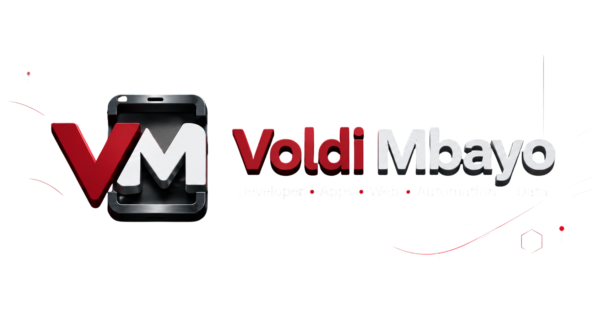

  

<h1 align="center">Voldi Mbayo</h1>
<h3 align="center">Full-Stack & Mobile Developer · Founder, Haven Labs</h3>

  
  

  I design and build useful digital products — from polished interfaces and cross-platform apps 
  to reliable APIs, data layers and cloud-backed experiences.

---

## `01 / Developer dashboard`

<table>
  <tr>
    <td width="50%" valign="top">
      <h3>PROFILE</h3>
      
<b>Role</b> — Full-Stack & Mobile Developer

      
<b>Studio</b> — Haven Labs

      
<b>Focus</b> — Mobile, web, backend & product

      
<b>Mode</b> — Building scalable, human-centered products

    </td>
    <td width="50%" valign="top">
      <h3>NOW</h3>
      
◉ Shipping Flutter experiences

      
◉ Building Django APIs

      
◉ Connecting products with Firebase

      
◉ Turning ideas into dependable systems

    </td>
  </tr>
</table>

## `02 / Technology matrix`

  
  
  
  
  
  

| Layer | Stack | What I deliver |
|:--|:--|:--|
| Mobile | **Flutter · Dart** | Cross-platform applications with clean, responsive UX |
| Backend | **Python · Django** | APIs, business logic and dependable services |
| Web | **JavaScript · HTML · CSS** | Fast, accessible and modern interfaces |
| Cloud | **Firebase** | Authentication, realtime data and product infrastructure |
| Delivery | **Git · GitHub** | Versioned, collaborative and maintainable releases |

## `03 / Product lab`

<table>
  <tr>
    <td width="50%" valign="top">
      <h3>TalentGrid</h3>
      
<b>Talent & opportunity platform</b>

      
A focused system designed to connect people, skills and opportunities through a clear product experience.

      <code>WEB · DATA · PRODUCT</code>
    </td>
    <td width="50%" valign="top">
      <h3>EK Talk Helper</h3>
      
<b>Communication support</b>

      
A practical mobile product designed to make communication clearer and more accessible.

      <code>MOBILE · UX · SYSTEMS</code>
    </td>
  </tr>
  <tr>
    <td width="50%" valign="top">
      <h3>VoFa Link</h3>
      
<b>Connected experience</b>

      
A platform concept centered on useful connections, simple flows and scalable architecture.

      <code>PLATFORM · API · MOBILE</code>
    </td>
    <td width="50%" valign="top">
      <h3>Haven Labs</h3>
      
<b>Digital product studio</b>

      
The home for building thoughtful web, mobile and AI-powered products with strong visual identity.

      <code>STUDIO · PRODUCT · ENGINEERING</code>
    </td>
  </tr>
</table>

> Selected work and verified live projects are available at **[voldimbayo.com/projects](https://www.voldimbayo.com/projects/)**.

## `04 / Live GitHub signal`

  
  

  

Live metrics are generated from public activity for <b>voldimbayo-blip</b>; no figures are entered manually.

---

<h3 align="center">BUILDING DIGITAL SYSTEMS THAT MOVE.</h3>

<b>FULL-STACK · MOBILE · PRODUCT · CREATIVE TECHNOLOGY</b>

<a href="https://www.voldimbayo.com">Explore the portfolio →</a>

